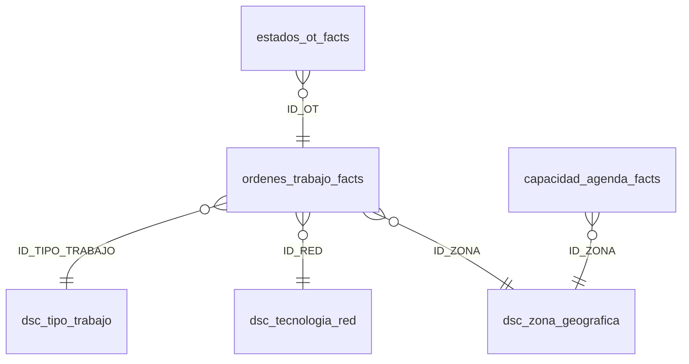

# Patrones de performance en SQL Server

Cinco optimizaciones de T-SQL que aplico sobre tablas de hechos de **cientos de millones de filas**, cada una con su versión **antes** y **después** y la explicación de por qué funciona. Incluye el **estándar de performance y estilo** que documenté para el equipo.


> **Sobre este repo:** los patrones salen de mi trabajo diario optimizando consultas sobre tablas de 825 a 984 millones de filas, donde eliminaron timeouts en procesos productivos. El modelo de datos y los nombres son de ejemplo (dominio de órdenes de trabajo técnicas), no los reales.

## Los cinco patrones

| # | Antes | Después | Qué se gana |
|---|---|---|---|
| [01](ejemplos/01_filtro_sargable) | `WHERE CONVERT(DATE, FECHA) = ...` | `WHERE FECHA >= @D AND FECHA < @D + 1` | *Index Seek* en lugar de leer toda la tabla |
| [02](ejemplos/02_prefiltrado_en_cte) | JOIN tabla grande contra tabla grande y filtro al final | CTEs que filtran y agregan **antes** del JOIN | JOIN chico contra chico; además corrige cupos sumados de más |
| [03](ejemplos/03_ultimo_estado_por_ot) | Subquery correlacionada / `OUTER APPLY TOP 1` | `ROW_NUMBER()` + `LAG()` en una sola lectura | Sin operaciones fila por fila; sin duplicados por empate |
| [04](ejemplos/04_itvf_en_lugar_de_escalar) | Función escalar con la regla de SLA | Inline table-valued function | Paralelismo y plan real visible para el optimizador |
| [05](ejemplos/05_exists_en_lugar_de_distinct) | `JOIN` + `DISTINCT` para tapar duplicados | `EXISTS` (semi join) | No genera filas de más ni esconde la causa |

Cada carpeta tiene `antes.sql`, `despues.sql` y un README con la explicación, los supuestos a validar y casos de ejemplo.

## Estándar del equipo

[**ESTANDAR_TSQL.md**](ESTANDAR_TSQL.md) resume las reglas: filtros por rango, pre-filtrado en CTEs, CTEs con nombres descriptivos, `ROW_NUMBER` en lugar de `APPLY`, iTVF en lugar de escalares, prefijos `Q_` / `FLAG_` / `PCT_` y consultas sin comentarios que se explican solas.

## Modelo de datos



- `dsc_*`: dimensiones (descripciones).
- `*_facts`: hechos. `ordenes_trabajo_facts` (una fila por OT), `estados_ot_facts` (historial de estados) y `capacidad_agenda_facts` (cupos por zona, día y franja).

## Cómo probarlo

1. Levantar un SQL Server (Developer Edition, Express, o Docker: `docker run -e ACCEPT_EULA=Y -e MSSQL_SA_PASSWORD=<tu_clave> -p 1433:1433 mcr.microsoft.com/mssql/server:2022-latest`).
2. Correr [`modelo/00_modelo_estrella.sql`](modelo/00_modelo_estrella.sql) y [`modelo/01_datos_demo.sql`](modelo/01_datos_demo.sql). Genera 2 millones de OT, sus estados y un año de agenda.
3. En cada ejemplo, ejecutar `antes.sql` y `despues.sql` con:

```sql
SET STATISTICS IO, TIME ON;
```

   y comparar las *logical reads* y el plan de ejecución real (Ctrl+M en SSMS).

---

Kevin Villagra · [LinkedIn](https://www.linkedin.com/in/kevin-villagra-data/)
